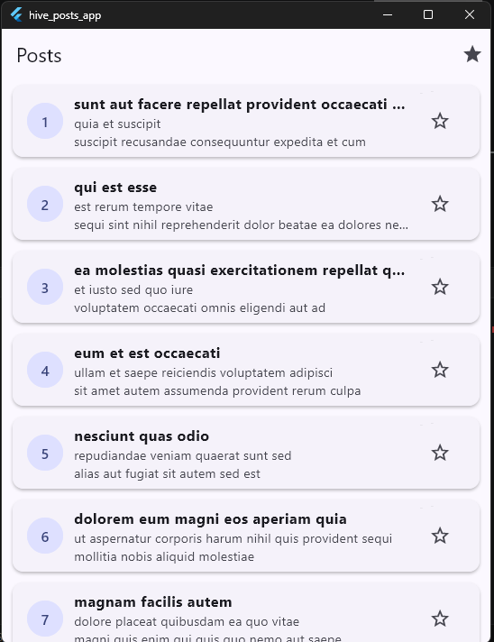
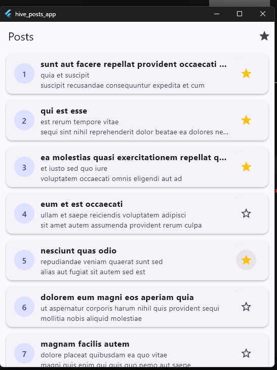
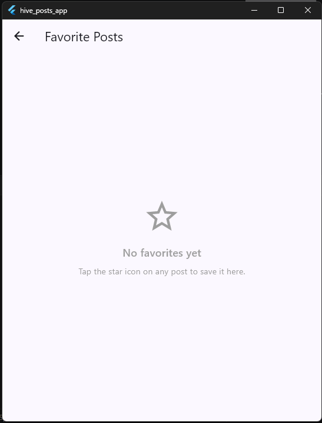
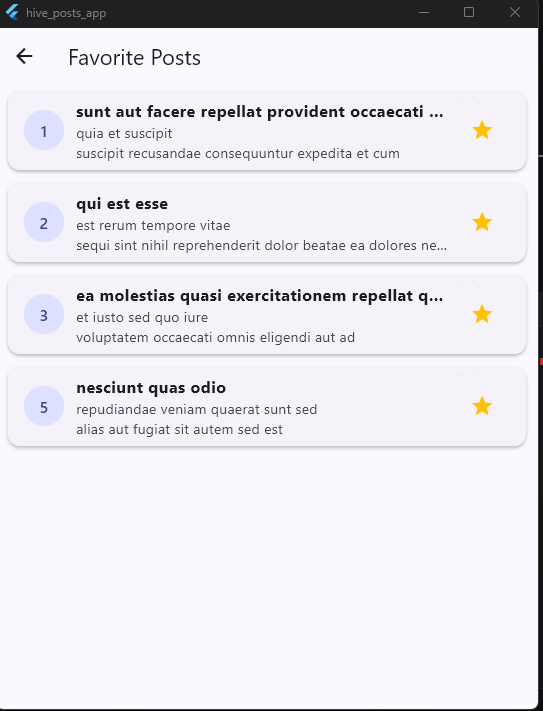
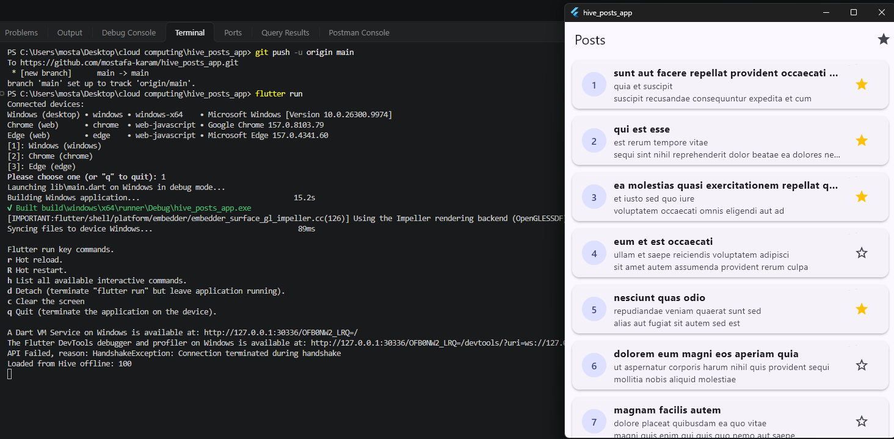
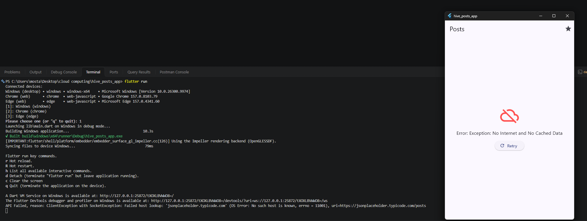

# Hive Posts & Favorites App

A Flutter app demonstrating **Hive** local NoSQL storage with offline caching and a favorites system.  
Built for **Fall 2026 – Section 5 Lab**.

---

## Features

- Fetch posts from [JSONPlaceholder API](https://jsonplaceholder.typicode.com/posts)
- Cache posts locally using Hive for offline access
- Add/remove favorites with a separate Hive box
- Immediate UI updates using `ValueListenableBuilder`
- Pull-to-refresh
- Graceful error handling (no internet + no cache)
- Favorites persist after app restart

---

## Screenshots

| Posts (Online) | Favorites Selected |
|:-:|:-:|
|  |  |

| Favorites Empty | Favorites Populated |
|:-:|:-:|
|  |  |

| Offline Cached | No Internet & No Cache |
|:-:|:-:|
|  |  |

---

## Project Structure

```
lib/
├── main.dart                    # Hive init, adapter registration, app entry
├── models/
│   ├── data.dart                # Part 1: Data model (typeId: 1)
│   ├── data.g.dart              # Generated adapter
│   ├── post_model.dart          # Post model (typeId: 0, extends HiveObject)
│   └── post_model.g.dart        # Generated adapter
├── services/
│   ├── post_service.dart        # API fetch + Hive cache fallback
│   └── favorites_service.dart   # Favorites CRUD with object cloning
└── screens/
    ├── posts_screen.dart        # Posts list with star toggle
    └── favorites_screen.dart    # Favorites list with empty state
```

---

## Dependencies

| Package | Version |
|---------|---------|
| hive | ^2.2.3 |
| hive_flutter | ^1.1.0 |
| http | ^1.1.0 |
| connectivity_plus | ^5.0.2 |
| hive_generator | ^2.0.1 |
| build_runner | ^2.4.7 |

---

## Getting Started

```bash
# 1. Clone the repo
git clone https://github.com/<your-username>/hive_posts_app.git
cd hive_posts_app

# 2. Install dependencies
flutter pub get

# 3. Generate Hive adapters
dart run build_runner build --delete-conflicting-outputs

# 4. Run the app
flutter run
```

---

## Testing

```bash
flutter analyze   # No issues found
flutter test      # 18/18 tests passed
```

---

## Offline Testing

| Step | Action | Expected |
|------|--------|----------|
| 1 | Run app with internet | Posts load from API |
| 2 | Star a few posts, close app, enable airplane mode | — |
| 3 | Reopen app in airplane mode | Cached posts appear, favorites preserved |
| 4 | Clear app data, stay offline, reopen | Error: "No Internet and No Cached Data" |
